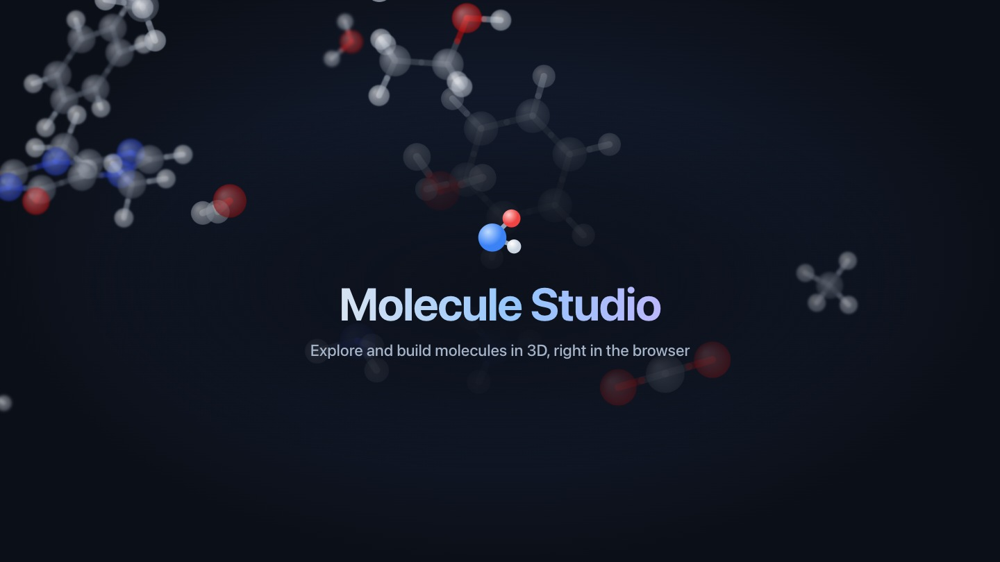
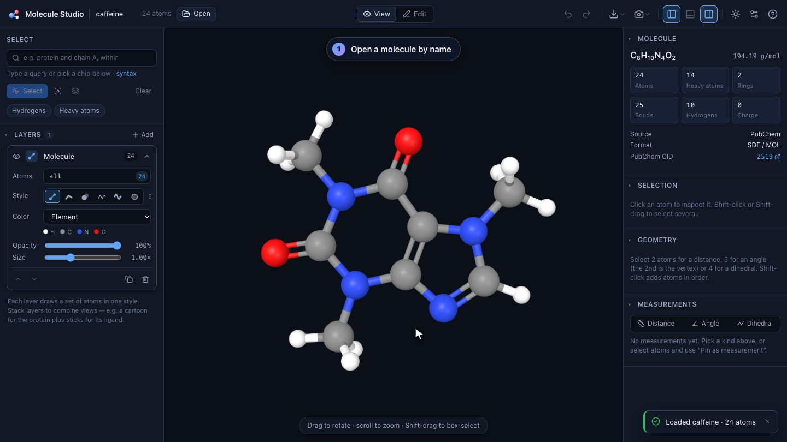
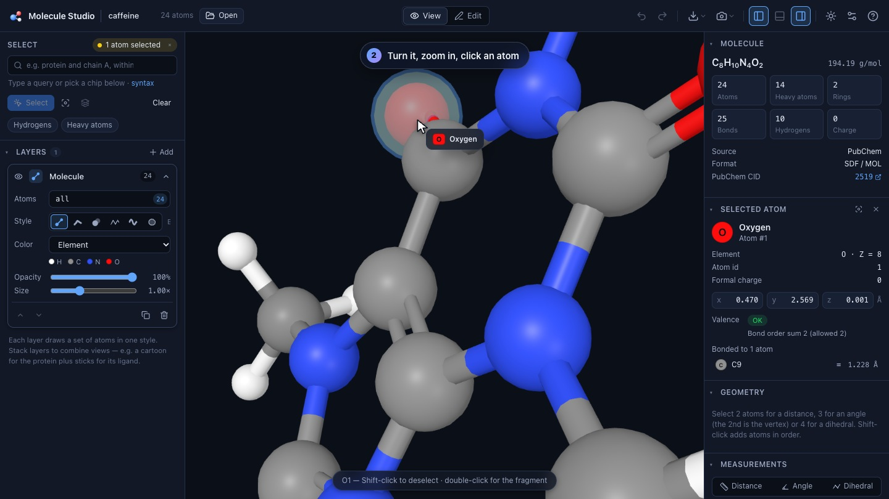
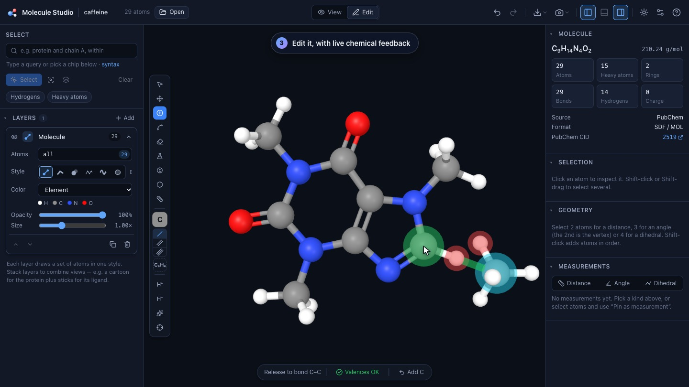
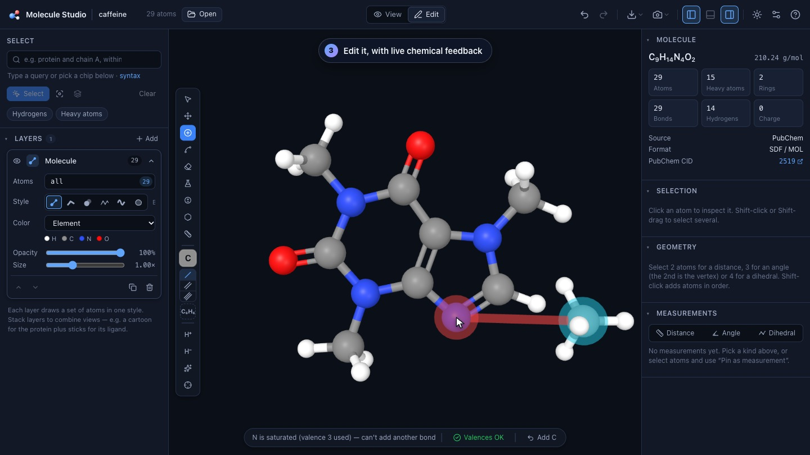
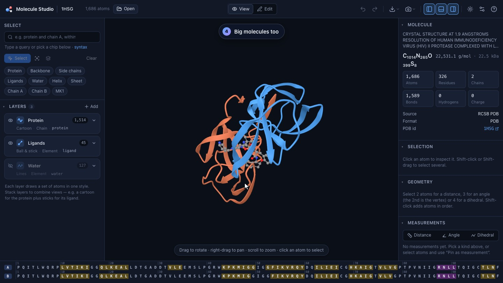
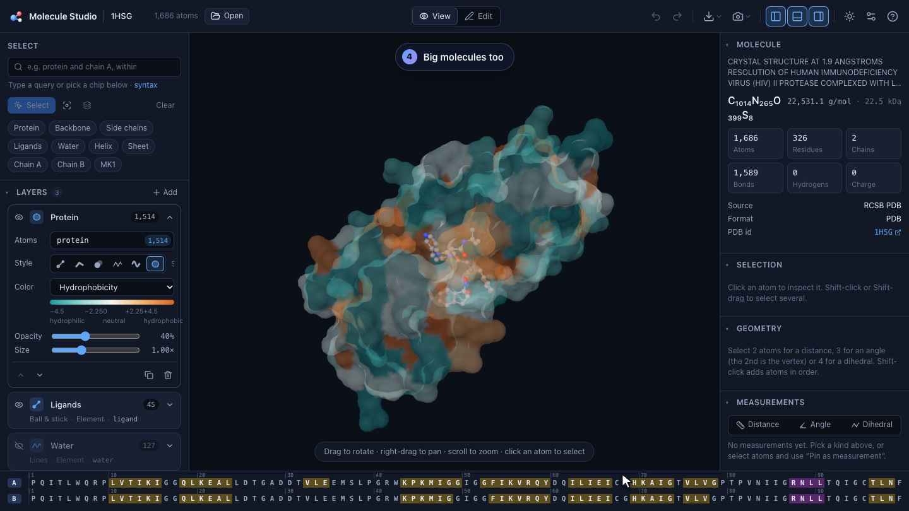

# Molecule Studio

An interactive 3D molecular visualizer and editor that runs in the browser. It is meant as a modern, approachable
alternative to tools like VMD: you load a structure, rotate and inspect it, and change how it is drawn from a few
panels instead of command menus. An edit mode lets you build and modify molecules by direct manipulation, with
immediate chemical feedback.

## Demo (1 minute)

[](demo/molecule-studio-demo.mp4)

[▶ Watch the demo video](demo/molecule-studio-demo.mp4) (54 s, with narration)

## Screenshots

| | |
| --- | --- |
|  |  |
| **Open a molecule by name.** Type “caffeine” and the 3D structure comes from PubChem; PDB ids, UniProt ids (AlphaFold), SMILES and files work too. | **Inspect.** Drag to turn, scroll to zoom, click any atom for its element, residue, coordinates and valence. |
|  |  |
| **Build with live feedback.** Drag out a bond: a green preview means the bond is chemically allowed… | **…and red means it is not**, with the reason in the status bar (“N is saturated — can't add another bond”). |
|  |  |
| **Big molecules too.** HIV-1 protease (PDB 1HSG) as a cartoon, coloured by chain, with its drug as ball and stick. | **Layers.** The same protein as a molecular surface coloured by hydrophobicity and made see-through to reveal the drug. |

## Running it

Requires Node 20 or newer.

```bash
npm install
```

```bash
npm run dev
```

Then open http://localhost:5173. Other scripts:

| Script | What it does |
| --- | --- |
| `npm run build` | Typecheck and build a static site into `dist/` |
| `npm run preview` | Serve the built site |
| `npm test` | Run the unit tests (vitest) |
| `npm run typecheck` | TypeScript check only |

## What it does

**Loading structures**
- Files (drag and drop anywhere, or the Open dialog): PDB, mmCIF (incl. chemical-component and crystal CIFs),
  SDF/MOL (V2000 and V3000), XYZ, MOL2.
- Online: RCSB PDB by id, PubChem by name or CID (3D conformer when available, otherwise 2D with generated 3D
  coordinates), AlphaFold DB by UniProt accession.
- SMILES strings, converted to 3D with a built-in embedder and force field.
- A gallery of 26 samples (8 of them embedded, so they work offline).
- After loading: bonds are perceived from distances where the file has none, bond orders are assigned (geometry-based
  for ligands, residue templates for standard amino acids and nucleotides) and protein secondary structure is computed
  with a simplified DSSP when the file has no HELIX/SHEET records.

**Viewing**
- Layers: each layer is a selection plus a drawing style (ball and stick, spacefill, licorice, lines, cartoon,
  molecular surface) and a color scheme (element, chain, residue, secondary structure, B-factor, hydrophobicity,
  rainbow, uniform), with opacity and size. Sensible layers are created automatically: a cartoon for proteins,
  sticks for ligands, spheres for ions.
- Selection language similar to VMD/PyMOL (`protein and chain A`, `within 5 of ligand`, `same residue as …`,
  `resname HIS`, `bfactor > 50`, …) with autocomplete, plus one-click chips and a clickable sequence strip.
- Clicking an atom shows its details; hovering shows a tooltip. Distances, angles and dihedrals can be measured and
  pinned. Labels, fog, orthographic or perspective projection, auto-rotate, light and dark themes.
- Export to PDB, SDF, XYZ or MOL2, and PNG screenshots (optionally transparent).

**Editing** (press `E` or use the View/Edit switch)
- Tools: select, move, add atom, add bond, delete, change element, change charge, attach fragment (rings, functional
  groups, chains), measure.
- Direct manipulation: click empty space to place an atom, click an atom to grow from it, drag from an atom to aim the
  new bond, drag between two atoms to bond them, drag atoms to move them (optionally with live relaxation by the
  force field).
- Real-time feedback while you work: ghost previews of new atoms and bonds, green/red highlighting of valid and
  invalid edits, suggested bonds, open-valence and over-valence markers, and a status bar that explains what a
  click will do.
- Hydrogens are added and removed automatically as you edit (can be turned off). Geometry inspector to set a bond
  length, angle or dihedral by slider, and a one-click geometry clean-up (force-field minimization).
- Full undo and redo with labelled history.

Press `?` in the app for all keyboard shortcuts.

## Project layout

```
src/
  core/      molecule model, chemistry rules, geometry, editing operations, force field, SMILES,
             bond and secondary-structure perception, selection language
  io/        file readers/writers, PDB/PubChem/AlphaFold fetchers, sample gallery
  render/    three.js viewer: representations, picking, overlays, labels, cartoon and surface builders
  editor/    pointer and keyboard interaction for the editing tools
  ui/        React components (shell, panels, dialogs, edit toolbar)
  state/     zustand store (document, undo history, layers, selection, view settings)
  app/       high-level actions (load, export, common commands)
demo/        the demo video and the scripts that make it (narration, scripted screen recording,
             music and mix: sh demo/build.sh <build-dir>)
docs/media/  screenshots used in this README
```

[ARCHITECTURE.md](ARCHITECTURE.md) describes the module contracts, data flow and conventions in detail.
